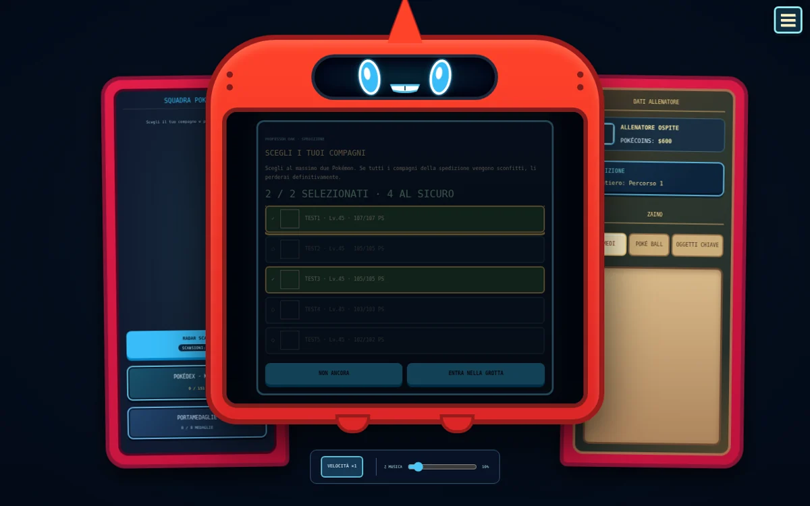
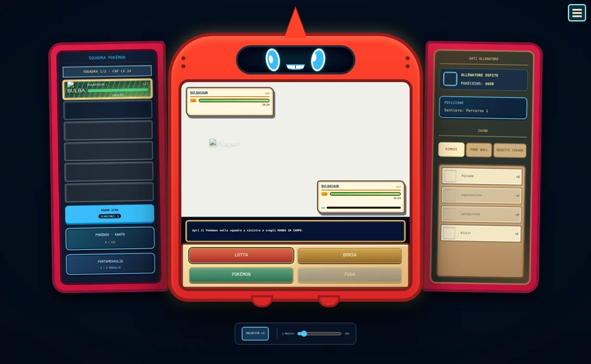
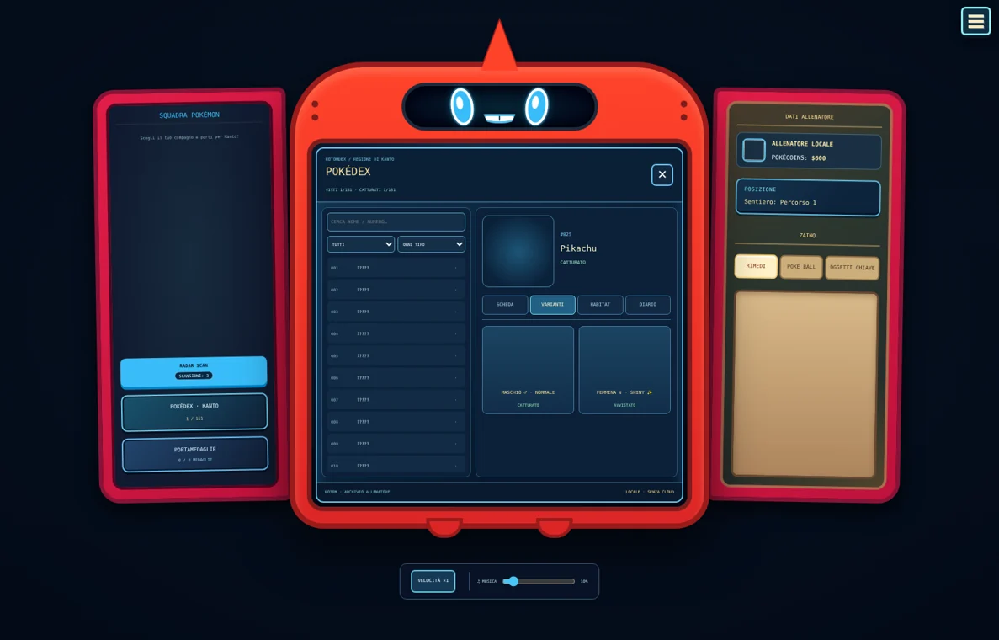

# 🎮 POKÉXPLORER

**Un’avventura Pokémon roguelike ambientata a Kanto**

*Esplora. Combatti. Cattura. Sopravvivi.*

**Versione Beta 1.8** · **Lingua: Italiano** · **Gioco fan-made per browser**

[💬 Entra nel server Discord](https://discord.gg/qNGscTEYHM) · [📂 Repository GitHub](https://github.com/nicolaloconte/pokexplorer)

---

## 🌍 Benvenuto a Kanto

In **Pokéxplorer** ogni nuova avventura mette alla prova le tue decisioni: scegli il tuo Pokémon iniziale, attraversa sentieri, villaggi e dungeon, affronta allenatori e Capipalestra e prepara una squadra capace di arrivare fino alla sfida finale.

La fortuna conta, ma non basta. Le catture, la gestione degli oggetti e le scelte nei momenti difficili possono cambiare l'esito della run.

## ✨ Cosa ti aspetta

| 🕹️ | Caratteristica |
| :---: | --- |
| 🗺️ | **Esplorazione roguelike** attraverso 80 piani, con combattimenti ed eventi. |
| ⚔️ | **Lotte Pokémon** contro selvatici, allenatori, boss e Capipalestra. |
| 🎒 | **Gestione della squadra** fino a sei Pokémon, con oggetti, evoluzioni e abilità. |
| 📖 | **Pokédex di Kanto** con 151 specie e scoperte persistenti tra le avventure. |
| ✨ | **Pokémon shiny** con probabilità base di 1 su 2.000 per le generazioni casuali. |
| 🏅 | **Medaglie e 17 obiettivi** da completare nel corso delle tue run. |
| 🏆 | **Personaggio Campione** da sbloccare vincendo una run con un solo Pokémon, usando un account Discord. |
| 🌌 | **Grotta Celeste**, una spedizione speciale in cui ogni scelta ha conseguenze. |

## 📸 Uno sguardo al gioco

### Battaglie e gestione dei Pokémon

### Pokédex e scoperte

*Le immagini mostrano schermate di sviluppo: l'interfaccia può cambiare con gli aggiornamenti.*

## 🎯 Come si gioca

1. Avvia una **Nuova Avventura** e scegli il protagonista e il compagno iniziale.
2. Esplora la mappa, affronta gli incontri e cerca nuovi Pokémon.
3. Usa **Poké Ball**, rimedi e abilità per far crescere la squadra.
4. Ottieni le medaglie e supera le sfide dei dungeon.
5. Prova a concludere la run e a completare gli **Obiettivi**.

**Comandi:** durante le battaglie puoi usare **WASD** o le **frecce** per spostare la selezione, **Spazio** per confermare ed **Esc** per tornare indietro quando possibile. I pulsanti sono utilizzabili anche con il mouse.

## 💾 Salvataggi e progressi

La Beta 1.8 include **checkpoint automatici** e un comando **Salva partita** per i momenti sicuri dell'avventura. Il Pokédex e gli Obiettivi dispongono di progressi associati all'account.

Per i salvataggi persistenti è necessario effettuare l'accesso con **Discord**. La modalità **UTENTE**, senza accesso, è pensata per provare il gioco e **non conserva permanentemente la partita**.

> Il salvataggio manuale non è disponibile durante battaglie, dialoghi ed eventi speciali della Grotta Celeste.

## 💬 Community

Novità, segnalazioni di bug, proposte e confronti tra giocatori si trovano nel server ufficiale:

**👉 [Unisciti al Discord di Pokéxplorer](https://discord.gg/qNGscTEYHM)**

## 👨‍💻 Crediti

**Creato e sviluppato da 17nico.**

Pokéxplorer è un progetto indipendente e fan-made, realizzato per passione verso il mondo Pokémon e i videogiochi roguelike.

## ⚖️ Avvertenze e diritti

**Pokéxplorer è un progetto fan-made non ufficiale.** Non è affiliato, sponsorizzato né approvato da Nintendo, GAME FREAK o The Pokémon Company. Pokémon e i relativi nomi, personaggi e materiali appartengono ai rispettivi titolari.

La disponibilità del repository e del sito **non costituisce di per sé una licenza di riutilizzo o redistribuzione** del codice originale e dei materiali del progetto. Per gli asset di terze parti valgono le rispettive condizioni e i diritti dei titolari. Prima della redistribuzione occorre verificare licenze e autorizzazioni applicabili.

---

**🌟 Ogni run è una storia diversa. La prossima sarà la tua?**

[💬 Discord ufficiale](https://discord.gg/qNGscTEYHM)

